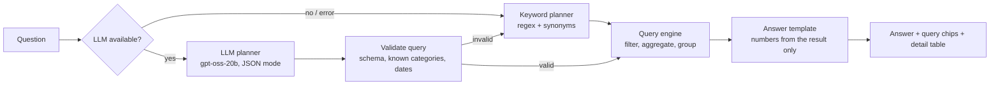

# Tally: ask your bank statement anything

[](https://github.com/saccromcyes/Financial-Analysis-CLI/actions/workflows/ci.yml)
[](https://saccromcyes-finance.onrender.com)
[](LICENSE)

Ask questions about your spending in plain English: *"How much did I spend on groceries in March?"*, *"Which category did I spend the most on?"*, *"What were my three largest purchases?"*

The obvious way to build this is to paste the transactions into a language model and let it answer. That gets the arithmetic wrong, and it can't show its working. Tally does it the other way round:

- **The model only translates.** It turns the question into a small JSON query (metric, filters, date range, grouping). It never sees the amounts and never writes a number.
- **The query is checked, then run exactly.** Unknown fields, invented categories and impossible dates are rejected. The engine computes the result in Java, and the sentence you read is a template filled with that result.
- **You see how it was read.** Every answer shows the query as plain chips ("total · money out · Groceries · 2025-03-01 to 2025-03-31"), so a misreading is obvious at a glance.
- **It keeps working without the model.** If the LLM is down, rate-limited or not configured, a keyword planner reads the question instead, and the page says so.

**[Try the live demo →](https://saccromcyes-finance.onrender.com)** It opens on a year of synthetic transactions; you can upload your own CSV. It runs on a free tier, so if nobody has used it for a while the first visit takes about a minute to wake up.

<!-- Screenshot added after the first deploy: docs/screenshot.png -->

## How it works



1. **Planning.** The LLM gets the question, the dataset's real category names, its most common merchants and its date range, and must reply with one JSON object. The prompt tells it to treat the question as data, not instructions.
2. **Validation.** `QuerySpec.fromMap` rejects unknown fields, categories the data doesn't have, bad dates, `from` after `to`, and non-numeric amounts, and clamps the limit to 1–50. Output that fails falls back to the keyword planner, so a bad model reply costs accuracy, never correctness.
3. **Execution.** `QueryEngine` supports sum, count, average, max, min and list, filtered by type (money in or out), categories, merchant, description text, date range and amount range, optionally grouped by category, month or merchant.
4. **Answering.** `AnswerWriter` turns the result into one sentence: "You spent $634.12 on Groceries in March 2025 (6 transactions)." Grouped results are summarised ("Spending on Subscriptions is usually $26.98 a month; the highest was $42.97 in August 2025") with the full table underneath.

## How well it understands questions

25 questions about the sample year, each with a hand-written correct query ([`eval/questions.json`](eval/questions.json)). A planner gets a question right when its query returns **the same numbers** as the correct one, even if the query is written differently. The table is rewritten by the [evaluation workflow](.github/workflows/eval.yml) on every run.

<!-- eval:start -->
| Planner | Correct | Accuracy | Avg. time |
|---|---|---|---|
| Keyword rules (fallback) | 22 / 25 | **88%** | 3 ms |
<!-- eval:end -->

The keyword planner misses three questions by design ("my three largest purchases", "money came in during March", "eating out or groceries"): they need the kind of reading the model is there for. CI fails if the keyword planner drops below 80%, so the fallback can't quietly get worse.

## The dashboard

Alongside the questions, the page shows what you'd want from a statement at a glance:

- **Money in and out by month**, with a three-month spending forecast. The forecast is the median of the last six months, so one big purchase doesn't skew it.
- **Where it went:** spending by category.
- **Worth a look:** transactions that stand out. A large purchase in a category seen only once in three or more months of data, a charge more than three standard deviations above its category's average, or the same subscription charged twice within five days. The sample has a few planted (a laptop, a double-charged streaming subscription) and the dashboard finds them.
- **Recurring charges:** the same merchant and amount in at least three different months, with the yearly cost.
- **Your own data:** upload a CSV (up to 1 MB). It is kept in memory for the session and never written to disk; the 20 most recent uploads are kept and older ones are dropped.

## Run it

Requires Java 21 and Maven.

```bash
mvn package
java -jar target/financial-analysis.jar --serve          # dashboard on http://localhost:7860
java -jar target/financial-analysis.jar --ask "How much did I spend on transport in Q2?"
java -jar target/financial-analysis.jar                   # the original terminal report
```

To use the language model planner, set an API key for any OpenAI-compatible endpoint. Groq's free tier works:

```bash
export LLM_API_KEY=...                                   # without it, the keyword planner is used
export LLM_BASE_URL=https://api.groq.com/openai/v1        # default
export LLM_MODEL=openai/gpt-oss-20b                       # default
```

| Option | Description | Default |
|---|---|---|
| `--serve` | Start the web dashboard | off |
| `--port <n>` | Port for `--serve` (also read from `PORT`) | `7860` |
| `--ask "<question>"` | Answer one question and print the query used | |
| `--csv <path>` | Your own transactions | bundled sample |
| `--threshold <amount>` | High-value cut-off for the terminal report | `500` |
| `--limit <n>` | Rows in terminal previews | `5` |
| `--export-dir <path>` | Where the terminal report writes Markdown, JSON and HTML | `out` |
| `--currency <code>` | USD, EUR, GBP or INR | `USD` |

### CSV format

```
date,description,category,type,amount,balance,destination
2025-01-12,Payment - Coffee,Food & Dining,DEBIT,4.50,2195.30,Coffee Shop
```

`type` is `DEBIT` (money out) or `CREDIT` (money in); amounts are positive. Rows that can't be read are reported by line number rather than silently skipped. The sample is generated by [`scripts/generate_sample.py`](scripts/generate_sample.py) with a fixed seed.

## API

| Endpoint | |
|---|---|
| `POST /api/ask` | `{"question": "...", "dataset": "sample" \| "<upload id>"}` → answer, query, value, groups, rows, timings. 30 questions per 10 minutes per client. |
| `POST /api/datasets` | CSV body (≤ 1 MB) → `{"id", "transactions"}` |
| `GET /api/summary?d=<id>` | Totals, months, categories, flagged transactions, recurring charges, forecast |
| `GET /api/eval` | The latest evaluation results |
| `GET /health` | Liveness |

## Engineering notes

- **No runtime dependencies.** The server is the JDK's `com.sun.net.httpserver`, the LLM client is `java.net.http`, and JSON is a small parser and writer in [`util/Json.java`](src/main/java/com/example/finance/util/Json.java) (depth-limited, and it escapes `<`, `>` and `&` so output is safe to embed in HTML). JUnit is the only dependency, for tests.
- **Untrusted input everywhere it enters.** Model output goes through schema validation; uploads are size-capped and parsed strictly; dataset ids must match a fixed pattern; static files are served from a whitelist of names inside the jar, so path tricks get a 404.
- **Tests** cover the query engine, query validation, the keyword planner, the LLM planner against a local fake endpoint (JSON mode, code fences, invented categories, HTTP errors), the fallback, JSON, CSV parsing, anomaly detection and forecasting, and the HTTP server end to end.
- **Free hosting, checked in CI.** The Docker image runs on Render's free instance (512 MB RAM, 0.1 CPU). A CI job starts the production image inside those limits and asks a real question before anything deploys.

## Project layout

```
src/main/java/com/example/finance/
  ask/       QuerySpec, QueryEngine, LlmPlanner, RulePlanner, AnswerWriter, AskService
  web/       WebServer (HTTP + API), DashboardService (anomalies, recurring, forecast)
  eval/      PlannerEval: scores planners against eval/questions.json
  analysis/  the original terminal report (ASCII charts, risk scoring, exports)
  io/ model/ util/
src/main/resources/web/    the dashboard (HTML, CSS, vanilla JS, SVG chart)
eval/                      questions with gold queries, and published results
```

## License

MIT
